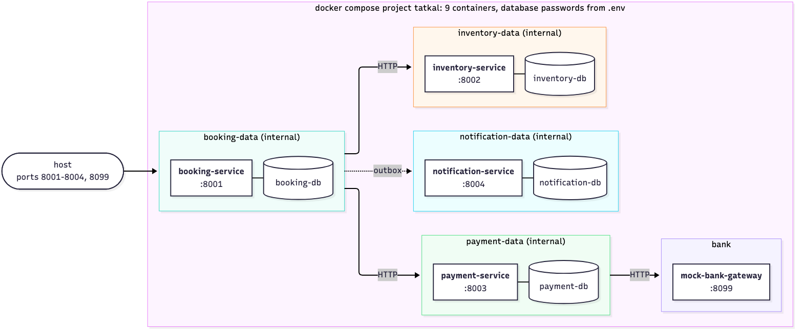

# Tatkal Booking System

Scalable Services (SEZG583), Assignments 1 and 2.

Team: Dhruv Bhat (2025TM93139), Ratani Snehi Rajesh Darshana (2025TM93530), Atharva Kadam (2025TM93221),
N Abhishek Reddy (2023MT93400).

Indian Railways opens a small **Tatkal** quota on every train at 10 AM the day before the journey, and a
very large number of people try to book those few seats in the same minute. We picked this because the
problems the assignment asks about show up on their own:

- the last 5 seats must never be sold to 20 people (concurrency),
- a passenger who taps "Pay" twice must not be charged twice (idempotency),
- "money debited but ticket not booked" must end with an automatic refund (saga with compensation),
- the bank tends to be slow or down right when everyone is paying (resilience).

The system is four business services and one mock bank, written in Python (FastAPI), each service with its
own PostgreSQL database and its own credentials. Services talk to each other only over REST.


| Service | Port | Database | What it does | Owner |
|---|---|---|---|---|
| [booking-service](services/booking-service) | 8001 | `booking_db` | Owns bookings and runs the booking saga: hold seats, take payment, confirm seats, notify | Dhruv Bhat |
| [inventory-service](services/inventory-service) | 8002 | `inventory_db` | Owns trains, fares and the Tatkal seat quota; the only place seats are held, confirmed or released | Ratani Snehi Rajesh Darshana |
| [payment-service](services/payment-service) | 8003 | `payment_db` | Owns payments and refunds; the only service that talks to the bank | Atharva Kadam |
| [notification-service](services/notification-service) | 8004 | `notification_db` | Sends booking SMS / e-mails and keeps the delivery log | N Abhishek Reddy |
| [mock-bank-gateway](services/mock-bank-gateway) | 8099 | none (in memory) | Simulated external UPI/card gateway that can be made slow, down or flaky | Atharva Kadam |

- **Assignment 1** (design and the three engineering challenges): report in [`docs/report/`](docs/report),
  evidence in [`evidence/`](evidence). The version we submitted is tagged
  [`assignment-1`](https://github.com/spaceman-dev/tatkal-booking-microservices/tree/assignment-1).
- **Assignment 2** (containers and deployment): sections 1 and 2 below, the deployment report in
  [`docs/deployment-report/`](docs/deployment-report) and the evidence in
  [`evidence/deployment/`](evidence/deployment).

## 1. Run everything with Docker Compose

You need Docker with Compose v2 (`docker compose version` should print a version) and free ports 8001-8004
and 8099. Nothing else: Python, PostgreSQL and the dependencies all come in the images.

```bash
git clone https://github.com/spaceman-dev/tatkal-booking-microservices.git
cd tatkal-booking-microservices
cp .env.example .env          # the four database passwords; change them, git ignores .env
docker compose up --build     # add -d to get the terminal back
```

The first build takes a minute or two. Compose starts the four databases first, then each service once its
database (and, for booking-service, the services it calls) reports healthy. In another terminal:

```bash
docker compose ps             # 9 containers, all "Up ... (healthy)"
curl localhost:8001/health    # {"status":"UP", ... "instance":"<container id>" ...}
```

Then book a ticket with the curl commands in [section 3](#book-a-ticket), or run the end-to-end tests and the
step-by-step demo against the containers. They need Python 3.11+ on your machine for the test tooling only:

```bash
python3 -m venv .venv && .venv/bin/pip install -r scripts/requirements.txt
.venv/bin/python -m pytest tests/e2e -v          # 7 tests: book, pay, confirm, notify and the failure paths
bash scripts/demo_flow.sh                        # the main flow step by step, Enter between steps
.venv/bin/python scripts/trace.py <correlation-id>   # one request followed through every container's log
```

Logs, health and stopping:

```bash
docker compose logs -f booking-service           # JSON lines, each with a correlation_id
docker inspect --format '{{json .State.Health}}' tatkal-booking-service-1
docker compose stop && docker compose start      # pause and resume
docker compose down                              # remove containers and networks, keep the data
docker compose up -d                             # back, with the same bookings
docker compose down -v                           # also delete the four databases
```

`bash scripts/restart_check.sh` does the down/up round trip and checks that the newest booking is still
there and the end-to-end tests still pass.

How it is put together:



- **One image per service** (`services/<name>/Dockerfile`): `python:3.12-slim`, dependencies in their own
  layer, the code owned by root and run by a normal user, a `HEALTHCHECK` on `/health`, `python -m app` as
  PID 1 so `docker stop` shuts it down cleanly. `.dockerignore` keeps `.env`, `.venv` and the tests out.
- **No passwords in images or in git.** They are only in `.env`. Compose puts them into each container's
  environment when it starts it, and builds `DATABASE_URL` from them.
- **Names, not localhost.** Inside the compose network the services reach each other as
  `http://inventory-service:8002` and their databases as `booking-db:5432`.
- **Separate networks.** Each database sits on an internal network shared only with its own service, so
  booking-service cannot even resolve `inventory-db`. Only payment-service can reach the bank. The
  databases are not published on the host.
- **Start order** comes from `depends_on: condition: service_healthy`; the data lives in four named volumes.

## 2. Run it on Kubernetes (Minikube)

```bash
minikube start --cpus=2 --memory=3500mb
bash deploy/k8s/deploy.sh            # builds the images, loads them into minikube, applies the manifests
bash deploy/k8s/port-forward.sh      # in its own terminal: the services on localhost:8001-8004 and 8099
LOG_SOURCE=k8s .venv/bin/python -m pytest tests/e2e -v
```

Stop the compose stack first (`docker compose down`), both use the same local ports. Scaling, deleting a
pod and rolling updates are described in [`deploy/k8s/README.md`](deploy/k8s/README.md).

## 3. Developing without containers (the Assignment 1 setup)

For working on the code it is handier to run the services on the host. You need:

- **Python 3.11 or newer** (we developed on 3.12; on macOS `python3` may still be 3.9, use `python3.12`)
- **Docker** with Compose, only for the four PostgreSQL databases. If you already have PostgreSQL 14+
  installed, see [Running without Docker](#running-without-docker).
- Free ports 8001-8004, 8099 and 5441-5444. Stop the compose stack first if it is running.

```bash
cp .env.example .env                                  # database passwords, shared with docker compose

# 1. the four databases (one container, user and password per service), on localhost:5441-5444
docker compose -f docker-compose.db.yml up -d

# 2. one virtualenv per service + a tooling venv for the scripts; creates every .env from .env.example
python scripts/stack.py setup

# 3. start all five services in the background (logs go to ./logs)
python scripts/stack.py start
python scripts/stack.py status
```

On Windows use `py scripts\stack.py ...` (or `python`); everything in `stack.py` is plain Python and works
the same on Windows, macOS and Linux.

### Book a ticket

The demo data has trains 12951, 12627, 22691 and 12009 with Tatkal quota for the next 7 days.

```bash
# what is available tomorrow on the Mumbai Rajdhani (replace the date)
curl "http://localhost:8002/api/v1/trains/12951/availability?journey_date=2026-11-05"

# book two seats - the Idempotency-Key is required because booking is not safe to repeat
curl -X POST http://localhost:8001/api/v1/bookings \
  -H "Content-Type: application/json" \
  -H "Idempotency-Key: 6f1c0d0b-7d0e-4a5c-9a3c-2f0a1b2c3d4e" \
  -d '{
        "train_no": "12951", "journey_date": "2026-11-05", "travel_class": "3A",
        "passengers": [{"name": "Asha Rao", "age": 34, "gender": "F"},
                       {"name": "Vikram Rao", "age": 36, "gender": "M"}],
        "contact": {"mobile": "9876543210", "email": "asha@example.com"},
        "payment": {"method": "UPI", "payer_ref": "asha@okmock"}
      }'
```

Send the same request again with the same key and you get the same response back with the header
`Idempotent-Replayed: true`, and no second booking or charge. Use a `payer_ref` starting with `decline` to
see a declined payment.

Every service has Swagger UI at `/docs` (for example http://localhost:8001/docs) and the raw spec at
`/openapi.json`. Exported copies of all specs are in [`docs/openapi/`](docs/openapi).

Stop everything with `python scripts/stack.py stop` and `docker compose -f docker-compose.db.yml down`
(add `-v` to delete the data).

## 4. Running one service by hand

Every service is independently runnable from its own folder with its own dependency file:

```bash
cd services/inventory-service
python -m venv .venv
source .venv/bin/activate          # Windows: .venv\Scripts\activate
pip install -r requirements-dev.txt   # app + pytest
cp .env.example .env               # Windows: copy .env.example .env
python -m app                      # starts on the PORT from .env
```

`python -m app` reads `HOST` and `PORT` from the environment. Tables are created on start-up and
inventory-service also inserts the demo trains.

## 5. Configuration

All configuration comes from environment variables. With Docker they are set in `docker-compose.yml`
(and the database passwords come from the root `.env`); on Kubernetes they come from a ConfigMap and a
Secret. On the host each service reads its own `.env` (created from `.env.example`), and real environment
variables override it. `PORT`, `DATABASE_URL` and the URLs of other services have no defaults, so a missing
value stops the service at start-up instead of quietly using the wrong thing.

| Variable | Service(s) | Default in .env.example | Meaning |
|---|---|---|---|
| `BOOKING_DB_PASSWORD`, `INVENTORY_DB_PASSWORD`, `PAYMENT_DB_PASSWORD`, `NOTIFICATION_DB_PASSWORD` | root `.env` | `change-me-...` | database passwords for docker compose, Kubernetes and `stack.py setup` |
| `PORT`, `HOST` | all | 8001-8004, 8099 / `0.0.0.0` | where the service listens |
| `DATABASE_URL` | the four business services | `postgresql+psycopg://<svc>_svc:<password>@localhost:544x/<svc>_db` (in Docker: `<svc>-db:5432`) | the service's own database |
| `LOG_LEVEL` | all | `INFO` | JSON logs on stdout |
| `INVENTORY_SERVICE_URL`, `PAYMENT_SERVICE_URL`, `NOTIFICATION_SERVICE_URL` | booking | `http://localhost:8002` / `8003` / `8004` | other services, HTTP only |
| `INVENTORY_TIMEOUT_SECONDS`, `PAYMENT_TIMEOUT_SECONDS` | booking | `3`, `10` | timeout per downstream call |
| `DOWNSTREAM_RETRIES` | booking | `1` | extra attempts for idempotent calls (hold, confirm, release, refund) |
| `IDEMPOTENCY_LEASE_SECONDS`, `IDEMPOTENCY_WAIT_SECONDS`, `IDEMPOTENCY_TTL_HOURS` | booking, payment | `60`, `20`/`15`, `24` | Idempotency-Key handling |
| `OUTBOX_POLL_SECONDS`, `RECOVERY_INTERVAL_SECONDS`, `COMPENSATION_RETRY_SECONDS`, `SAGA_STUCK_AFTER_SECONDS` | booking | `2`, `10`, `20`, `60` | background jobs |
| `GATEWAY_URL`, `GATEWAY_TIMEOUT_SECONDS`, `GATEWAY_MAX_ATTEMPTS`, `GATEWAY_BACKOFF_BASE_SECONDS`, `GATEWAY_BACKOFF_CAP_SECONDS` | payment | `http://localhost:8099`, `2.0`, `3`, `0.2`, `2.0` | bank calls: timeout, retries, exponential backoff with full jitter |
| `SEED_DEMO_DATA`, `SEED_DAYS` | inventory | `true`, `7` | demo trains and quota |
| `HOLD_STRATEGY`, `NAIVE_THINK_TIME_MS` | inventory | `atomic`, `150` | `naive` exists only to demonstrate the race in Challenge 1 |
| `HOLD_EXPIRY_ENABLED`, `HOLD_TTL_SECONDS`, `HOLD_SWEEP_INTERVAL_SECONDS` | inventory | `true`, `600`, `30` | fallback: holds still HELD after 10 minutes are released |
| `ADMIN_API_ENABLED` | inventory, notification | `true` | dev-only `/api/v1/admin/*` (fault injection, strategy switch). Turn off outside a dev machine |
| `PROVIDER_FAILURE_RATE`, `PROVIDER_LATENCY_MS` | notification | `0.0`, `30` | simulated SMS provider |
| `CLAIM_LEASE_SECONDS`, `DUPLICATE_WAIT_SECONDS` | notification | `30`, `2.0` | how long a message being sent stays claimed; how long a duplicate event waits for it |
| `GATEWAY_MODE`, `GATEWAY_LATENCY_MS`, `GATEWAY_SLOW_LATENCY_MS`, `GATEWAY_FAILURE_RATE` | mock-bank-gateway | `normal`, `80`, `4000`, `0.5` | start-up behaviour; can be changed at runtime with `PUT /gateway/v1/admin/mode` |

Example: `HOLD_STRATEGY=naive python scripts/stack.py restart inventory-service`.

## 6. Tests

```bash
python scripts/stack.py test        # unit + integration tests of every service (databases must be up)
```

- **Unit tests** (`services/*/tests/unit`) cover every business rule BR1-BR7 and need nothing running.
- **Integration tests** (`services/*/tests/integration`) use the service's real PostgreSQL database:
  20 threads racing for 5 seats, a retried hold overlapping the first one, parallel duplicate payments,
  refunds racing a charge that is still running, duplicate and partly failed notification events, the
  saga with forced failures, and recovery after a simulated crash. They skip themselves if the database
  is down.
- **End-to-end test** of the main transaction, through the public APIs of all services (stack running):

```bash
source .venv/bin/activate           # tooling venv created by setup; Windows: .venv\Scripts\activate
python -m pytest tests/e2e -v
```

## 7. Engineering challenge scripts

With the host setup from section 3 running and the tooling venv active. The scripts also read each
service's database on localhost:5441-5444 to check the results, and `docker-compose.yml` does not publish
the databases, so they are meant for that setup:

| Script | Challenge | What it shows |
|---|---|---|
| `python scripts/challenge1_concurrency.py --strategy both` | 1. Concurrency | 20 parallel bookings for 5 seats: the naive check-then-update oversells, the real code confirms 5 and rejects 15 with 409 |
| `python scripts/challenge2_idempotency.py` | 2. Idempotency | sequential, failed, mismatched and 10 simultaneous repeats of one key; one booking, one charge |
| `python scripts/challenge3_saga.py` | 3C. Saga with compensation | failure forced at step 3 is undone (refund, then release); a failed compensation is finished by the recovery job (waits ~30 s) |
| `python scripts/bank_failure_modes.py` | condition (e) | one booking each with the bank normal, slow, down and flaky: one capture at most, seats released on failure |
| `python scripts/check_db_isolation.py` | database per service | every service's credentials against every database; only its own connects |

Each script prints its result and saves a timestamped copy under `evidence/`. Useful options:
`--capacity`, `--requests`, `--seats` (challenge 1) and `--skip-recovery` (challenge 3).

## 8. Business rules

| Id | Rule | Where |
|---|---|---|
| BR1 | Seats of a train/date/class are never over-allocated; a request that does not fully fit is refused | inventory-service |
| BR2 | A Tatkal booking has 1 to 4 passengers, each at least 5 years old | booking-service |
| BR3 | The fare is computed on the server: base fare + Tatkal charge (class percentage, clamped to min/max) | inventory-service |
| BR4 | A booking is charged at most once; only money that was really taken can be refunded, in full, once | payment-service |
| BR5 | A booking only moves along its state machine | booking-service |
| BR6 | If the saga fails, whatever may have happened is undone newest-first: refund, then release | booking-service |
| BR7 | Cancelling a confirmed Tatkal ticket returns the seats but refunds nothing | booking-service |

[`docs/business-rules.md`](docs/business-rules.md) maps every rule to the code and to its tests.

## 9. Repository layout

```
docker-compose.yml           the whole application in containers: 4 databases + 5 services (Assignment 2)
.env.example                 the database passwords to copy into .env (placeholders only)
docker-compose.db.yml        only the four databases, for running the services on the host
services/
  booking-service/           Dockerfile, app/{api,services,domain,repository,clients,core}, tests/,
                             requirements.txt (+ requirements-dev.txt with pytest), .env.example
  inventory-service/         same layout
  payment-service/           same layout
  notification-service/      same layout
  mock-bank-gateway/         small stand-alone mock, no database
deploy/k8s/                  Kubernetes manifests for Minikube and the deploy / port-forward / watch scripts
scripts/                     stack.py, challenge scripts, demo_flow.sh, trace.py, restart_check.sh, export_openapi.py
tests/e2e/                   end-to-end test of the main transaction
docs/                        both reports, diagrams (Mermaid source + PNG/SVG), OpenAPI specs, business rules
evidence/                    one folder per challenge (Assignment 1) and evidence/deployment (Assignment 2)
```

Inside a service: `api/` is HTTP only (routes, request/response models), `services/` holds the use cases
(the saga, holds, payments), `domain/` holds the business rules as plain functions, `repository/` holds the
tables and SQL, and `clients/` the HTTP clients for other services. `core/` is small shared plumbing
(logging, correlation id, error format); it is copied into each service on purpose so that no service
depends on a shared library.

## 10. Troubleshooting

With Docker Compose:

- **`docker: unknown command: docker compose`**: the Compose v2 plugin is missing. Docker Desktop has it;
  with Homebrew (`brew install docker-compose`) add `"cliPluginsExtraDirs": ["/opt/homebrew/lib/docker/cli-plugins"]`
  to `~/.docker/config.json`.
- **`required variable BOOKING_DB_PASSWORD is missing a value`**: there is no `.env`; run `cp .env.example .env`.
- **`port is already allocated`**: something else uses 8001-8004 or 8099, often the host setup from section 3
  (`python scripts/stack.py stop`) or a minikube port-forward.
- **A container keeps restarting or stays unhealthy**: `docker compose ps`, then `docker compose logs <service>`.
  While a service waits for its database it logs which database it tries (password hidden) and the error.
- **`password authentication failed` after changing a password in `.env`**: PostgreSQL only uses
  `POSTGRES_PASSWORD` when it creates the database, the volume keeps the old one. Either start over with
  `docker compose down -v`, or keep the data and change it inside the database:
  `docker compose exec booking-db psql -U booking_svc -d booking_db -c "ALTER USER booking_svc PASSWORD '<new>'"`.
- **Inside a container `localhost` is the container itself.** Never point a containerised service at
  `localhost:<port>` (like the host `.env` files do); use the compose service name.

With the host setup:

- **A service does not become healthy**: look at `logs/<service>.log`. Most often the database is not up
  (`docker compose -f docker-compose.db.yml ps`) or a port is taken.
- **Port already in use**: change `PORT` in that service's `.env`, and the matching URL in
  `services/booking-service/.env` if it is one booking-service calls.
- **Start again from empty databases**: `docker compose -f docker-compose.db.yml down -v`, then `up -d`.
- **Python version errors**: `python --version` must be 3.11+; on Windows try `py -3.12 scripts\stack.py setup`.

### Running without Docker

With a local PostgreSQL 14+, create the four databases and users once (as a superuser):

```sql
-- use the passwords from your .env
CREATE USER booking_svc PASSWORD '<booking password>';           CREATE DATABASE booking_db OWNER booking_svc;
CREATE USER inventory_svc PASSWORD '<inventory password>';       CREATE DATABASE inventory_db OWNER inventory_svc;
CREATE USER payment_svc PASSWORD '<payment password>';           CREATE DATABASE payment_db OWNER payment_svc;
CREATE USER notification_svc PASSWORD '<notification password>'; CREATE DATABASE notification_db OWNER notification_svc;
REVOKE CONNECT ON DATABASE booking_db, inventory_db, payment_db, notification_db FROM PUBLIC;
```

Then change `DATABASE_URL` in each service's `.env` to port 5432.
