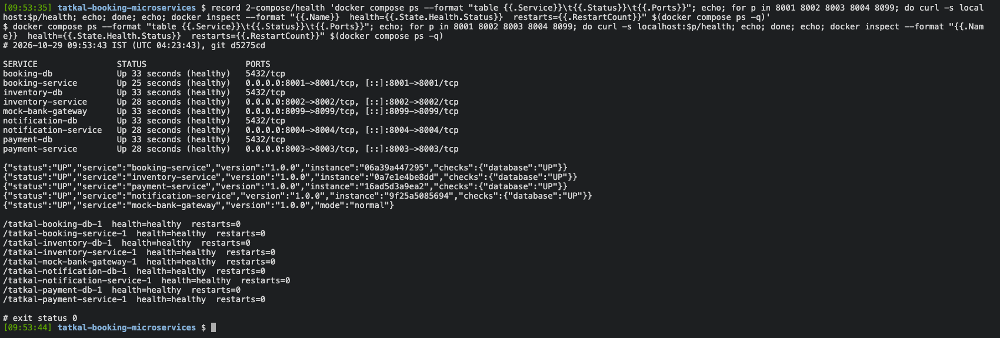
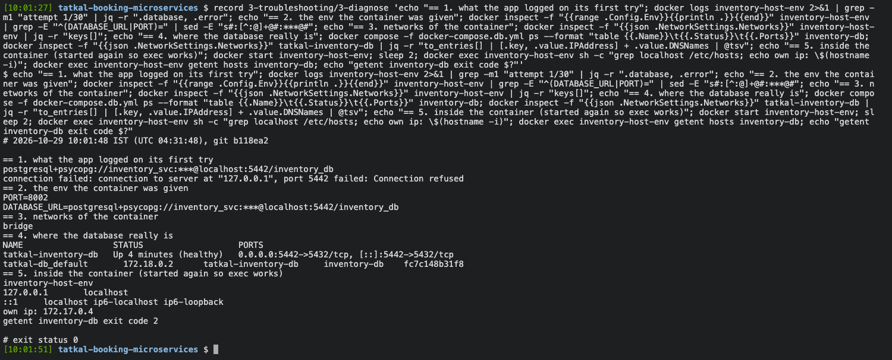
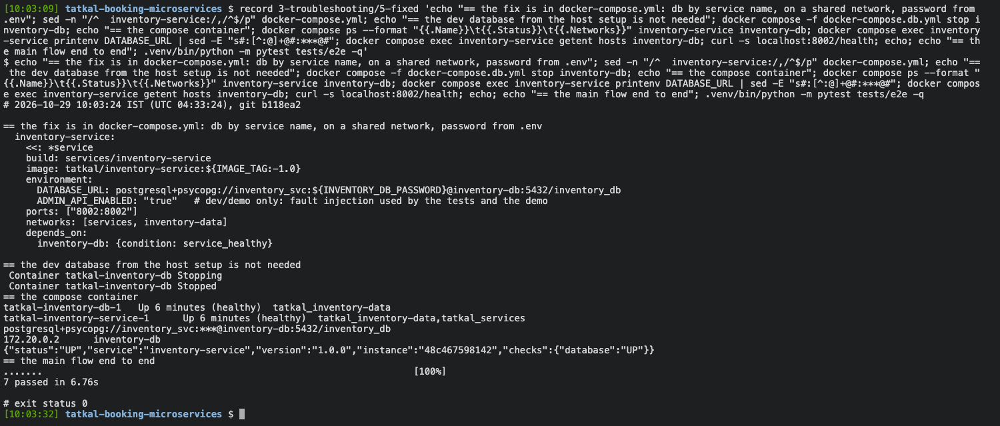
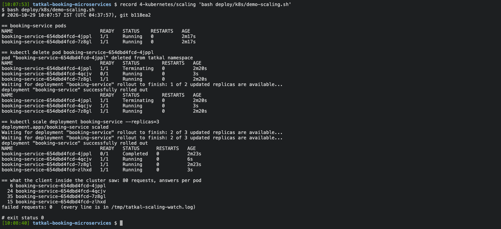
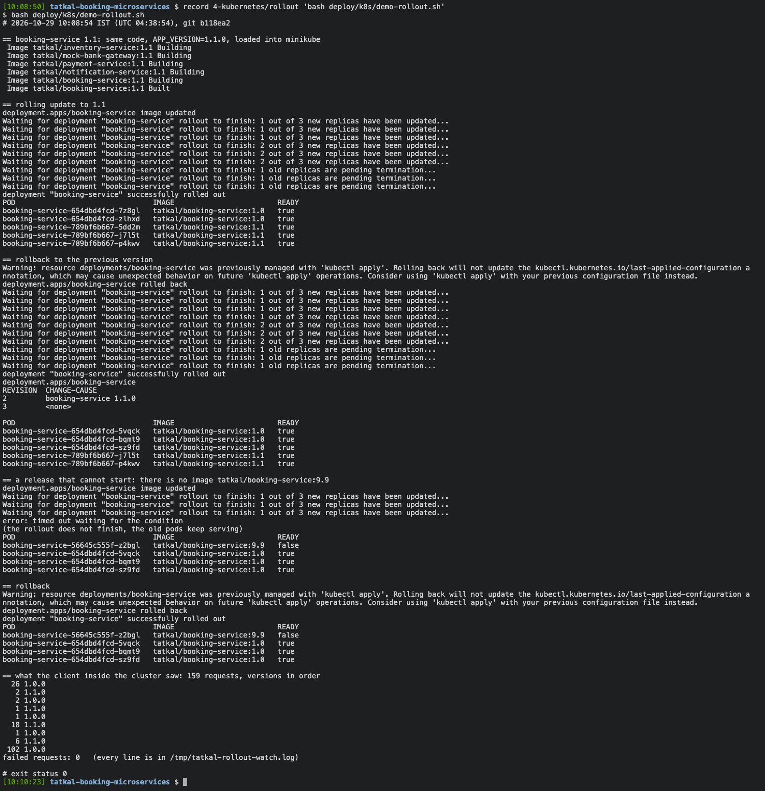

::: cover

**Scalable Services (SEZG583) - Assignment 2 - Deployment Report**

| Group member | BITS ID | Main work in Assignment 2 |
|----------------|--------|--------------------------|
| Dhruv Bhat | 2025TM93139 | `docker-compose.yml`, networks and secrets, restart check, report |
| Ratani Snehi Rajesh Darshana | 2025TM93530 | Dockerfiles and images, health endpoints |
| Atharva Kadam | 2025TM93221 | the deployment problem (Task 3), configuration and start-up logging |
| N Abhishek Reddy | 2023MT93400 | Kubernetes manifests, scaling and rollout, demo video |

Source code: <https://github.com/spaceman-dev/tatkal-booking-microservices> (Assignment 1 ends at the tag
`assignment-1`, everything after it is Assignment 2)\
Demo video: <https://drive.google.com/drive/folders/1-ilHc5i5Y-p0t5t8ioswWVQGG0qH4uBT?usp=sharing>

:::

# 1. Application and deployment overview

The application is our Assignment 1 project, the back end for booking Indian Railways Tatkal tickets: a
few seats open at a fixed time and thousands of people try to book them in the same minute. It has four
business services and a mock bank, all in Python (FastAPI). booking-service runs each booking as a saga:
hold seats in inventory-service, take the payment through payment-service (which talks to the bank),
confirm the seats, and tell notification-service through an outbox. Each business service owns its own
PostgreSQL database, and the services talk to each other only over REST.

For this assignment we built one image per service and run the whole system in two ways: with Docker
Compose (`docker compose up --build`, nine containers) and on Minikube. The code does not know where it
runs. Every address and password reaches it through environment variables. Figure 1 shows the Compose
deployment.


# 2. Containerization and Docker Compose

## 2.1 Images

Each service has a Dockerfile in its own folder (`services/<name>/Dockerfile`), built as
`tatkal/<name>:1.0`. All five follow the same pattern:

- **Base and layers.** `python:3.12-slim`. `requirements.txt` is copied and installed before the code, so
  a code change rebuilds only the last layers. The four services with a database come to 348 MB each, the
  mock bank to 274 MB. pytest moved to `requirements-dev.txt` so it no longer goes into the images.
- **Non-root.** The code is owned by root and the process runs as `tatkal` (uid 10001), so the service can
  read its code but not change it.
- **Configuration from outside.** Only `HOST`, `PORT` and `APP_VERSION` have defaults in the image. The
  database URL, the other services' URLs and the log level are given when the container starts.
  `.dockerignore` keeps `.env`, `.venv` and the tests out of the build context, so a password cannot be
  copied in by mistake. We checked the built images with `docker image inspect` and by listing `/app`
  inside them.
- **Health check.** `HEALTHCHECK` calls the service's own `/health` with Python (the slim image has no
  curl). `--start-interval=2s` makes a new container healthy a few seconds after start-up.
- **Clean stop.** `CMD ["python", "-m", "app"]` in exec form, so Python is PID 1 and receives SIGTERM from
  `docker stop` and from Kubernetes.

We also added to the code: `/health` reports the version and the container (`instance`), and a new
`/health/live` only says the process is running, without touching the database. Compose and the Kubernetes
readiness probe use `/health`, the liveness probe uses `/health/live`. That way a database outage takes a
pod out of its Service instead of restarting it over and over.

## 2.2 docker-compose.yml

- **Nine containers:** four `postgres:16-alpine` databases, each with its own user, database and volume,
  and the five services.
- **Passwords only in `.env`.** The file uses `${BOOKING_DB_PASSWORD:?...}`, so Compose stops with a clear
  message when `.env` is missing, and builds each `DATABASE_URL` from it. `.env` is ignored by git; the
  repository has `.env.example` with placeholders.
- **Service names, never localhost:** `INVENTORY_SERVICE_URL=http://inventory-service:8002`, and the
  database host is `booking-db:5432`.
- **Six networks:** `services` for the REST calls, `bank` for payment-service and the bank only, and one
  `internal` network per database, shared with its own service only.
- **Start order:** `depends_on` with `condition: service_healthy`. The databases come up first, then each
  service once its database is ready, and booking-service last because it calls the other three.
- `restart: unless-stopped` everywhere, and json-file logs capped at 3 x 10 MB per container.

## 2.3 Running it

| What we did | Result (files in `evidence/deployment/`) |
|------------------|----------------------------|
| `docker compose build --no-cache` | five images built with BuildKit (`1-images`) |
| `docker compose up --build -d --wait` | all nine containers healthy about 11 s after the start (`2-compose/up.txt`) |
| `/health` of each service, `docker inspect` | all `UP` with the database `UP`, 0 restarts (`health.txt`) |
| main workflow: 7 end-to-end tests and the demo script | book, pay, confirm, notify; a failure at step 3 refunded and released; a declined payment; sold out. 7 passed (`e2e.txt`, `demo_flow.txt`) |
| one booking followed through the logs | its correlation id appears in all five containers, in order (`trace.txt`) |
| name lookups from inside booking-service | its own database and the three services resolve, the other databases and the bank do not (`networks.txt`) |
| `docker compose down`, then `up -d --wait` | the newest confirmed booking (PNR 8394445298) is still there, the 7 tests pass again (`restart.txt`) |

# 3. Situated learning: the container that could not find its database

**Problem.** Once the first Dockerfile was ready we ran the inventory-service image on its own, with the
`.env` file we had been using on the laptop since Assignment 1:
`docker run -d --name inventory-smoke -p 8002:8002 --env-file services/inventory-service/.env tatkal/inventory-service:1.0`.
The development database was up and healthy on `localhost:5442`, and the service with that same file had
worked fine outside Docker. The container started but stayed at `health: starting`, curl got an empty
reply, and after 30 seconds it exited with code 3. The log said `database not reachable yet (attempt
n/30)` thirty times and then `Application startup failed`.

**Diagnosis.** We worked from the outside in:

| Command | What it told us |
|----------------------|--------------------------|
| `docker ps -a`, `docker inspect -f '{{.State.ExitCode}}'` | exit code 3 and unhealthy: the service gave up on its own, nothing killed it |
| `docker logs` | 30 failed attempts one second apart, but no reason |
| `docker inspect` (environment, networks) | `DATABASE_URL=...@localhost:5442/inventory_db`; the container is on the default `bridge` network |
| `docker compose -f docker-compose.db.yml ps`, `docker inspect tatkal-inventory-db` | the database is healthy, published as 5442 on the host, and on the network `tatkal-db_default` with the DNS name `inventory-db` |
| `docker exec ... grep localhost /etc/hosts` | inside the container `localhost` is `127.0.0.1` / `::1` of the container itself |
| `docker exec ... getent hosts inventory-db` | the name does not resolve from the `bridge` network |
| a database connection from a container of the same image | `connection to server at "127.0.0.1", port 5442 failed: Connection refused` |

The image was fine, the configuration was wrong. `localhost:5442` means "this machine", and inside a
container this machine is the container. Port 5442 exists only on the host, where Docker publishes the
database. To confirm it we changed only the address in the URL (`localhost:5442` to `inventory-db:5432`)
and attached the database's network: the same image with the same file was healthy within 8 seconds, with
no failed attempt.

**Solution.** (1) In `docker-compose.yml` every `DATABASE_URL` uses the database's service name and port
5432, and each service shares a private network with its database. The other services' URLs work the same
way. (2) The per-service `.env` files are only for running on the host. They stay out of the images
(`.dockerignore`) and are never passed to containers, which get their settings from Compose, and on
Kubernetes from ConfigMaps. (3) The wait-for-database log line now shows the target, with the password
hidden, and the reason, so the cause is in the first line:
`...@localhost:5442/inventory_db ... Connection refused`.

**Validation.** In the Compose deployment, `docker compose exec inventory-service printenv DATABASE_URL`
shows `inventory-db:5432`, `getent hosts inventory-db` resolves, `/health` reports the database `UP` and
the 7 end-to-end tests pass. `evidence/deployment/3-troubleshooting` has each step with screenshots, plus
the raw output from the morning it first happened.

**Learning.**

- Inside a container, `localhost` is the container. Containers reach each other by name on a shared
  network. A published port is for the host, not for other containers.
- Configuration does not carry over from a laptop into containers. Each environment needs its own
  configuration (Compose `environment`, ConfigMaps), and the developer's `.env` should never go in.
- A log line that only says "not reachable" made the diagnosis slow. Logging the target and the reason
  turns minutes into seconds.
- Run one container alone before wiring up the rest. When it fails, only the image or its configuration
  can be wrong.

In a real deployment we would apply this by making every service log its effective configuration
(without secrets) at start-up and fail fast with a clear message when a dependency is missing, and by
keeping each environment's configuration in its deployment files rather than in files copied from
someone's machine.

# 4. Advanced: Kubernetes on Minikube

## 4.1 Deployment and main workflow

`deploy/k8s/` has the manifests (Figure 2), and `bash deploy/k8s/deploy.sh` deploys everything to Minikube
1.39 (Kubernetes 1.37):

- It builds the images with Compose and copies them in with `minikube image load` (no registry,
  `imagePullPolicy: IfNotPresent`), creates the Secret `db-passwords` from the same `.env`, and runs
  `kubectl apply -k`.
- Each database is a StatefulSet with a headless Service and a 1 Gi PersistentVolumeClaim. Each service is
  a Deployment, a ClusterIP Service and a ConfigMap with the other services' URLs. `DATABASE_URL` is put
  together from the Secret with `$(DB_PASSWORD)`.
- An init container waits with `pg_isready` until the pod's database answers, like `depends_on` in
  Compose. Startup and liveness probes use `/health/live`, the readiness probe `/health`. The service and
  database containers have CPU and memory requests and a memory limit.
- booking-service runs 2 replicas with `maxSurge: 1, maxUnavailable: 0`. inventory-service and the mock
  bank stay at one replica, because the fault switches used in the demo are kept in memory.


A clean deploy took 41 s. The very first one took 3 min 36 s, almost all of it waiting for the pods while
Minikube downloaded the postgres image. The main workflow runs through the Kubernetes Services: with
`port-forward.sh` running, the same 7 end-to-end tests pass, reading the logs with `kubectl logs`, and one
booking's correlation id appears in the logs of all five Deployments.

## 4.2 Self-healing and scaling

`demo-scaling.sh` deletes one of the two booking-service pods and then scales the Deployment to 3, while
a pod inside the cluster calls booking-service twice a second. A replacement pod was running 3 s after the
delete, and the third replica was ready 3 s after `kubectl scale`. The client made 80 requests, all
answered, by four different pods.

## 4.3 Rolling update and rollback

`demo-rollout.sh` rolls booking-service out to 1.1 (the same code with `APP_VERSION=1.1.0`), rolls back
with `kubectl rollout undo`, then deploys a tag that does not exist (9.9). That pod never gets ready,
`maxUnavailable: 0` keeps the three 1.0 pods serving, and a second `undo` removes it. 159 requests during
all of this, none failed.

It was not like that the first time. 3 of 141 requests failed during our first update and rollback, each
just as an old pod was stopping: Kubernetes sends SIGTERM and removes the pod from the Service endpoints at
the same time, so for a moment requests still reached a stopping pod. A `preStop` sleep of 5 s fixed it
(0 of 139 afterwards). Running replicas also showed a race we had never seen with one copy of each service:
replicas that create their tables at the same moment can crash with `UniqueViolation` (3 of 4 in our
test). Table creation now runs under a PostgreSQL advisory lock. Both are described in Appendix C.

# 5. Contributions and AI use

| Member | Assignment 2 work | Share |
|-------------|--------------------------------|-----|
| Dhruv Bhat | `docker-compose.yml` (networks, health-based start order, passwords from `.env`), `restart_check.sh`, the evidence runs, report sections 1, 2.2 and 5 | 25 % |
| Ratani Snehi Rajesh Darshana | the five Dockerfiles and `.dockerignore`, `/health` with version and instance, `/health/live`, checking the images, report section 2.1 | 25 % |
| Atharva Kadam | Task 3: reproducing and diagnosing the localhost problem, the better start-up log, `.env.example` files with placeholders, report section 3 | 25 % |
| N Abhishek Reddy | Kubernetes manifests and scripts, the preStop and advisory-lock fixes, report section 4, video editing | 25 % |

**AI-use declaration.** We used GitHub Copilot in VS Code (agent mode) for this assignment too. It wrote
the Dockerfiles, `docker-compose.yml`, the Kubernetes manifests, the deploy and demo scripts and the small
code changes (health endpoints, start-up log, `create_tables`). It ran the builds and deployments and
recorded the evidence. The problems in section 3 and Appendix C came up during those runs, and the files
in `evidence/` are not edited (passwords are masked when they are printed). It also drafted this report,
the READMEs and a plan for the video. Our part: we decided what to show for Task 3 and which advanced tasks
to attempt, went through every Dockerfile, the Compose file and the manifests until each of us could
explain them, and each of us ran `docker compose up --build` from a fresh clone on our own laptop.

# Appendix A - Commands {.newpage}

```bash
# Docker Compose
cp .env.example .env                         # put your own passwords in .env
docker compose up --build -d --wait
docker compose ps                            # 9 containers, all healthy
python3 -m venv .venv && .venv/bin/pip install -r scripts/requirements.txt    # Python 3.11+, tests only
.venv/bin/python -m pytest tests/e2e -v
bash scripts/demo_flow.sh
bash scripts/restart_check.sh

# the Task 3 problem, on purpose (the .env.example has the same localhost URL as our old .env)
docker compose -f docker-compose.db.yml up -d --wait inventory-db
docker run -d --name inventory-host-env -p 8012:8002 \
  --env-file services/inventory-service/.env.example tatkal/inventory-service:1.0
docker ps -a; docker logs inventory-host-env 2>&1 | tail -3
docker inspect -f '{{range .Config.Env}}{{println .}}{{end}}' inventory-host-env | grep DATABASE_URL
docker exec inventory-host-env getent hosts inventory-db; echo $?
docker rm -f inventory-host-env; docker compose -f docker-compose.db.yml down

# Kubernetes
docker compose down                          # frees the local ports for the port-forward
minikube start --cpus=2 --memory=3500mb
bash deploy/k8s/deploy.sh
bash deploy/k8s/port-forward.sh              # second terminal
LOG_SOURCE=k8s .venv/bin/python -m pytest tests/e2e -v
bash deploy/k8s/demo-scaling.sh
bash deploy/k8s/demo-rollout.sh
```

# Appendix B - Evidence index

Everything was recorded on 29 Oct 2026. Every file starts with the command, the time and the commit.

| Folder in `evidence/deployment/` | What it shows |
|-----------|---------------------------------|
| `1-images` | the clean build of the five images; sizes, user, ports, command, environment and files of each image |
| `2-compose` | `up`, health, the 7 end-to-end tests, the demo script, a trace across services, network isolation, logs, `down` and `up` with the data kept, and our very first `compose up` |
| `3-troubleshooting` | the Task 3 problem: symptom, exit, diagnosis, the one-change confirmation, the fix and the tests; the raw output of the first time it happened |
| `4-kubernetes` | deploy, resources, the 7 tests through port-forward, demo, trace, self-healing and scaling (80 requests, 0 failed), rollout and rollback (159 requests, 0 failed), and the first deploy |
| `5-other-problems` | the rolling update that dropped requests, before and after the preStop fix; the table-creation race before and after the advisory lock |

The service test suites were run again after the changes: 133 passed (`evidence/tests`).

# Appendix C - Other problems we hit

| Problem | How it showed up | What we changed |
|-------------|------------------|------------------|
| `docker compose` was not found on the Mac | `docker: unknown command: docker compose`, although the plugin was installed with Homebrew | pointed Docker at Homebrew's plugin folder (`cliPluginsExtraDirs` in `~/.docker/config.json`) |
| the first build used the old builder | Compose warned that it `requires buildx plugin` (`2-compose/first-up.txt`) | installed buildx; builds use BuildKit since |
| one end-to-end test failed against the containers | 6 of 7 passed: the log check read old files in `logs/`, while the containers log to stdout | the test and `trace.py` read `docker compose logs` or `kubectl logs` (`LOG_SOURCE`, detected automatically) |
| `demo_flow.sh` failed at step 1 | `python3` on macOS is 3.9, the scripts need 3.11+ | the script uses the virtualenv's Python; `stack.py` checks the version and says what to install |
| a rolling update dropped requests | 3 of 141 failed (connection refused, timeouts) while old pods stopped | `preStop` sleep 5 s and `terminationGracePeriodSeconds: 30`: 0 of 139, later 0 of 159 (commit `c264040`) |
| replicas starting together crashed | `race_check.py` with 4 replicas on an empty schema: 3 `UniqueViolation` on `pg_type_typname_nsp_index` | `create_tables()` takes `pg_advisory_xact_lock` first; 4 of 4 start; regression test added (commit `4511fed`) |

# Appendix D - Screenshots










