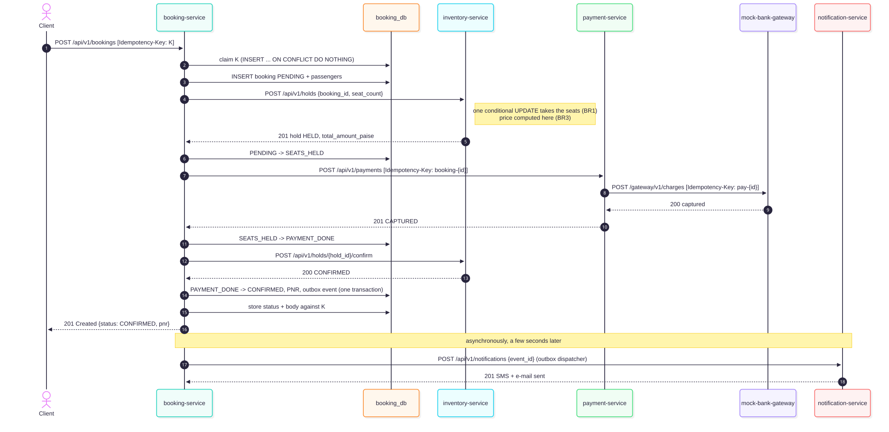
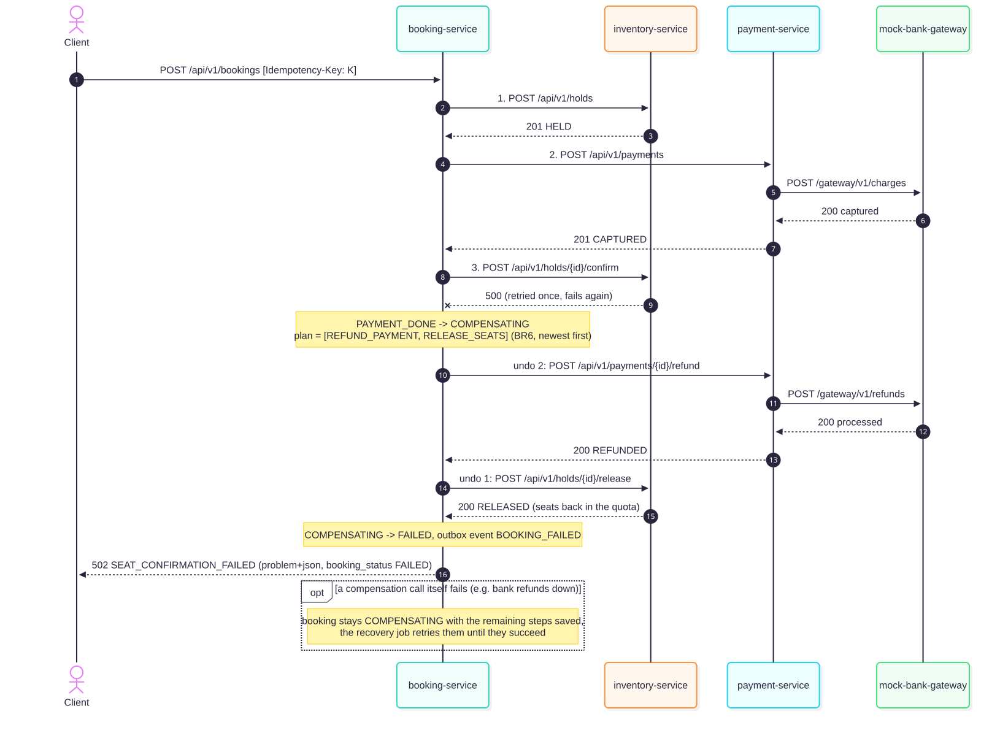
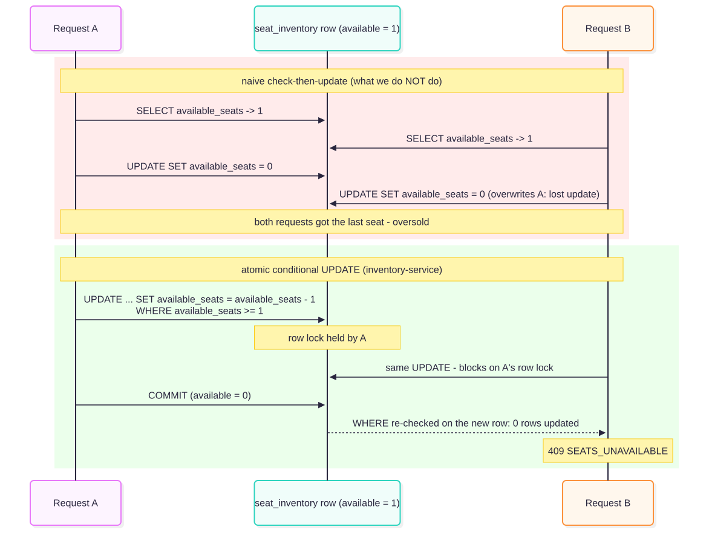

::: cover

**Scalable Services (SEZG583) - Assignment 1 - Design and Technical Report**

| Group member | BITS ID | Service owned |
|---|---|---|
| Dhruv Bhat | 2025TM93139 | booking-service (saga orchestrator) |
| Ratani Snehi Rajesh Darshana | 2025TM93530 | inventory-service |
| Atharva Kadam | 2025TM93221 | payment-service and mock-bank-gateway |
| N Abhishek Reddy | 2023MT93400 | notification-service, end-to-end tests |

Source code: <https://github.com/spaceman-dev/tatkal-booking-microservices>\
Demo video and documents: [Google Drive link]

:::

# 1. Problem and scope

## 1.1 Overview

Every Indian Railways train keeps a small **Tatkal** quota per class that opens one day before the
journey (10:00 for AC classes, 11:00 for the rest). Many more people want these seats than there are
seats. Anyone who has tried knows the first few minutes: thousands of attempts at the same time, seats
shown as free that are gone a second later, people pressing "Pay" again because the bank page is stuck,
and the usual "amount debited but ticket not booked, refund in 5-7 days".

We built the back end for this. A passenger asks for 1-4 seats on a train, date and class. The system
holds the seats, takes the payment through a bank, confirms the seats, gives a PNR and sends an SMS and
e-mail. Most of our effort went into the cases around that flow: requests that arrive together, requests
that arrive twice, and steps that fail half way.

The five conditions from the brief map onto the domain like this:

| Condition | In our system |
|---|---|
| (a) 4+ services with distinct responsibilities | booking, inventory, payment, notification (plus a mock bank) |
| (b) a transaction spanning 3+ services | booking a ticket: inventory (hold), payment (charge, via the bank), inventory (confirm), notification |
| (c) a contended resource | the Tatkal seat quota of one train/date/class, e.g. the last 5 seats in Sleeper |
| (d) an operation unsafe to repeat | `POST /bookings` and `POST /payments` (they take seats and money) |
| (e) a dependency that can be slow or fail | `mock-bank-gateway` (normal, slow, down, flaky, refunds-only outage) and a simulated SMS provider |

## 1.2 Assumptions

- A booking is for one train, one date and one class, with 1-4 passengers. Every booking is a Tatkal
  booking; general quota, waiting list and RAC are not modelled.
- Seats are sold as a count per class. Berth numbers are allotted later (at charting) and are not part of
  this system.
- Each train/date/class has a base fare; the Tatkal charge follows the published Indian Railways rule
  (BR3). All money is stored as integer paise.
- The 10:00/11:00 opening time is not enforced, so the system can be demonstrated at any time.
- Payment is UPI or card through an external gateway that we do not control (simulated by our mock).
- A passenger is identified only by a mobile number; there are no accounts.

## 1.3 Business rules

| Id | Rule | Owner |
|---|---|---|
| BR1 | The seats of a train/date/class are never over-allocated. A request that does not fully fit is refused (no partial allocation). | inventory |
| BR2 | A Tatkal booking has 1 to 4 passengers, each aged 5 or more (children under 5 travel without a berth). | booking |
| BR3 | The fare is computed by the server: per-seat fare = base fare + Tatkal charge, the charge being 10 % (2S) or 30 % (other classes) of the base fare, clamped to the class minimum and maximum (for example Rs 300-400 in 3A). The client never sends a price. | inventory |
| BR4 | A booking is charged at most once. Only money that was really taken can be refunded, in full and only once. | payment |
| BR5 | A booking moves only along its state machine (section 3.4). | booking |
| BR6 | If the booking saga fails, everything that may have happened is undone, newest first: refund, then release the seats. A compensation that cannot run now is retried until it succeeds. | booking |
| BR7 | Only a confirmed booking can be cancelled. Its seats return to the quota, but a confirmed Tatkal ticket gets no refund. | booking |

Each rule is a plain function in the owning service's `domain/` package and has unit tests.
`docs/business-rules.md` maps every rule to its code and tests (summary in Appendix D).

## 1.4 Out of scope

Login and authorisation, any user interface, real payment and SMS providers (both are mocks we wrote),
seat or berth selection, waiting list and charting, the booking-window rule, PNR enquiry for other
passengers, and deployment (Docker images and Minikube are Assignment 2). Clients are our scripts,
Swagger UI and curl.

# 2. Service decomposition

## 2.1 Responsibilities

| Service | Responsibility in one sentence | Owns | Main operations |
|---|---|---|---|
| **booking-service** | Owns a passenger's booking from request to ticket (or failure) and orchestrates the steps needed to get there. | bookings, passengers, saga log, idempotency keys, outbox | place booking (saga), get, list, saga log, cancel |
| **inventory-service** | Owns trains, fares and the Tatkal quota, and is the only place seats can be held, confirmed or released. | trains, seat_inventory, seat_holds | availability, open quota, hold, confirm, release |
| **payment-service** | Owns money movements for bookings and is the only service that talks to the bank. | payments, refunds, idempotency keys | charge, refund, look up |
| **notification-service** | Tells the passenger what happened and keeps a record of every message sent. | notifications | deliver event (SMS, e-mail), list |
| mock-bank-gateway | Stands in for the external UPI/card gateway (not a business service). | nothing persistent | charge, refund, look up, behaviour switch |

## 2.2 Why these boundaries

We split by **business capability** (CS05). Selling seats, taking money, managing a passenger's booking
and messaging the passenger are separate jobs in a railway, done by different teams. The common closure
principle gives the same answer, since each service changes for its own reasons: a fare revision or a new
class only touches inventory, a new bank or refund policy only payment, a new passenger rule only booking,
and a new SMS template or provider only notification.

The split also follows the data. Only inventory writes the seat counter and only payment writes money,
so the two rules we care about most, no overselling (BR1) and no double charge (BR4), can each be
enforced in one local database transaction. Booking owns neither seats nor money. It owns the
*lifecycle* of a booking, and that is why it coordinates the other two.

The services also behave differently under load, which will matter in Assignment 2. Inventory is the hot
spot during a rush, payment mostly waits for a slow bank, and notification can fall a few minutes behind
without hurting anyone.

## 2.3 Alternatives we rejected

- **A separate train-catalogue service.** Trains and schedules look like their own subdomain, but every
  hold needs the fare and the quota together, and they change together. Splitting them would turn every
  hold into a two-service call, which is the "services that call each other on every request" problem
  the brief warns about.
- **One checkout service (booking + payment).** They are always used together, but payment has its own
  consistency rules (BR4), its own external dependency and its own failure modes. Keeping it separate
  isolates the slow bank and lets cancellations and compensations use the same refund operation.
- **Sending SMS from booking-service.** That would put a slow, failure-prone external call inside every
  booking request. A separate notification service fed asynchronously means a dead SMS provider cannot
  fail a booking.
- **A dedicated "saga orchestrator" service.** It would own no data and need to know every other
  service's API (a god service). The orchestration belongs next to the booking state it changes.
- **An API gateway.** With one entry point for writes (booking) and one read API (availability) it would
  only add a component in Assignment 1. In Assignment 2 a Kubernetes Ingress can play that role.

# 3. Architecture

## 3.1 Components

{width=100%}

All services are Python 3.12 with FastAPI, talk HTTP/JSON, and each has its own PostgreSQL 16 database
(four containers, four users). Each service is a self-contained folder with its own `requirements.txt`,
`.env.example`, tests and README, and is started with `python -m app`.

The booking steps are **synchronous** because the passenger is waiting for a yes or no, and step 2
needs the price from step 1. The longest chain is client -> booking -> payment -> bank (three hops). We
put the bank behind payment so that its slowness is handled in one place. Booking calls inventory and
payment one after the other, so that part is a fan-out rather than a chain. Notifications are
**asynchronous**: booking writes an event into an outbox table in the same transaction as the status
change, and a background dispatcher delivers it.

Every service handles the cross-cutting parts the same way:

- **Configuration** only from environment variables (or a `.env` file); service URLs, ports and database
  URLs have no defaults, so a missing one stops the service at start-up.
- **Correlation id**: taken from the `X-Correlation-ID` header or generated, stored in a context
  variable, added to every log line, forwarded on every outgoing call and returned in the response. The
  outbox stores it with the event, so the SMS sent later still logs under the original request's id.
- **Logs** are one JSON object per line on stdout (`ts, level, service, correlation_id, msg, ...`).
- **`GET /health`** reports the service and checks its database (503 if the database is unreachable).

## 3.2 Main transaction - happy path

{width=80%}

## 3.3 Main transaction - failure at step 3

{width=82%}

This is the "money debited, ticket not booked" case. In our system it is sorted out inside the same
request: the passenger gets `502 SEAT_CONFIRMATION_FAILED` with `booking_status: FAILED`, the payment is
`REFUNDED`, the seats are back in the quota and a refund SMS follows. The other failure paths use the
same mechanism with a shorter plan: sold out at step 1 (nothing to undo, 409), bank declines at step 2
(release only, 402), bank unreachable (release only, 503), bank silent (refund if taken, then release, 504).

## 3.4 State machines

{width=100%}

A seat hold goes HELD -> CONFIRMED -> RELEASED (or HELD -> RELEASED, also after a 10-minute expiry), and a
payment PENDING -> CAPTURED -> REFUNDED (or PENDING -> DECLINED / FAILED / VOIDED); both diagrams are in
`docs/diagrams/`. The hold protects other passengers while a saga is running: between steps 1 and 3 the
seats are HELD, so nobody else can sell them (a semantic lock).

# 4. Data design

## 4.1 One database per service

{width=74%}

{width=100%}

{width=58%} {width=38%}

*payment_db (left) and notification_db (right). Foreign keys exist only inside one database; the ids of
other services' entities are plain columns.*

## 4.2 Data ownership

| Data | Owner (only writer) | Other services keep | How they get it |
|---|---|---|---|
| Trains, fares, quota counters, seat holds | inventory | booking: `hold_id` and the quoted `amount_paise` | response of `POST /holds`; `GET /holds?booking_id=` |
| Bookings, passengers, saga log, outbox | booking | inventory, payment and notification: `booking_id` | `GET /bookings/{id}` |
| Payments, refunds | payment | booking: `payment_id`, `refund_paise` | response of `POST /payments`; `GET /payments?booking_id=` |
| Messages sent | notification | - | `GET /notifications?booking_id=` |

## 4.3 Cross-service references

There are no foreign keys or joins across services. A service keeps only the ids of other services'
entities and asks the owner when it needs more. Integrity across services comes from the saga, helped by
uniqueness on the referencing side: `UNIQUE (booking_id)` in `seat_holds` and in `payments` allows only
one hold and one payment per booking, even when a step is retried. Booking keeps two copies on purpose:
the amount quoted at hold time (the price the passenger agreed to, even if the fare changes later) and
the refunded amount.

The four databases are separate containers with their own users. CS07 compares physical and logical
separation. Physical separation costs a little more memory, but nobody can cross the boundary by
accident and it maps directly onto one database per pod in Assignment 2. `scripts/check_db_isolation.py`
tries every service's credentials against every database, and only the 4 diagonal combinations connect
(evidence in `evidence/database-per-service/`). Our evidence scripts do read all four databases to check
outcomes, but they join the results by id in Python like a reporting job would. No service does this.

# 5. API design

## 5.1 Conventions

All paths are versioned (`/api/v1/...`), bodies are JSON with snake_case names, ids are UUIDs, money is
integer paise and dates are ISO 8601. Request models reject unknown fields, so a typo such as
`passanger` fails loudly. Status codes: 201 created, 200 read or replay, 400 bad header, 402 payment
declined, 404 unknown resource, 409 conflict with current state, 422 invalid request or broken business
rule, 502/503/504 when a downstream step failed (with the booking's final status in the body). Every
service serves Swagger UI at `/docs`; exported OpenAPI 3.1 files are in `docs/openapi/`.

## 5.2 Endpoints

| Service | Method and path | Purpose | Main responses |
|---|---|---|---|
| booking | `POST /api/v1/bookings` (Idempotency-Key) | run the booking saga | 201, 402, 404, 409, 422, 502, 503, 504 |
| booking | `GET /api/v1/bookings`, `GET /api/v1/bookings/{id}` | list (filters) / read | 200, 404 |
| booking | `GET /api/v1/bookings/{id}/saga` | every step and compensation | 200, 404 |
| booking | `POST /api/v1/bookings/{id}/cancel` | cancel (BR7), safe to repeat | 200, 404, 409, 503 |
| inventory | `GET /api/v1/trains`, `GET /api/v1/trains/{no}/availability` | catalogue, seats left and fares | 200, 404 |
| inventory | `POST /api/v1/inventory`, `GET /api/v1/inventory` | open a Tatkal quota / read counters | 201, 404, 409 |
| inventory | `POST /api/v1/holds` | step 1, idempotent per booking_id | 201 new, 200 existing, 404, 409 |
| inventory | `POST /api/v1/holds/{id}/confirm`, `/release` | step 3 / compensation | 200, 404, 409 |
| payment | `POST /api/v1/payments` (Idempotency-Key) | step 2 | 201, 402, 409, 503, 504 |
| payment | `POST /api/v1/payments/{id}/refund` | compensation, at most once | 200, 409, 503 |
| payment | `POST /api/v1/payments/void` | compensation when no payment exists yet | 200 |
| payment | `GET /api/v1/payments?booking_id=`, `/{id}` | read | 200, 404 |
| notification | `POST /api/v1/notifications` | deliver an event, duplicates ignored | 201, 200 duplicate, 422, 503 |
| all | `GET /health` | liveness + database check | 200, 503 |

## 5.3 Sample request and responses

```http
POST /api/v1/bookings
Idempotency-Key: 8d3c1f52-2b7e-4f0a-9c61-3e5a7d9b1c04
X-Correlation-ID: report-sample-01

{"train_no": "12951", "journey_date": "2026-11-05", "travel_class": "3A",
 "passengers": [{"name": "Asha Rao", "age": 34, "gender": "F"},
                {"name": "Vikram Rao", "age": 36, "gender": "M"}],
 "contact": {"mobile": "9876543210", "email": "asha@example.com"},
 "payment": {"method": "UPI", "payer_ref": "asha@okmock"}}
```

```http
HTTP/1.1 201 Created
X-Correlation-ID: report-sample-01

{"booking_id": "90756b9d-7a11-4110-a581-fa7dd2cb267f",
 "pnr": "2441510525", "status": "CONFIRMED",
 "train_no": "12951", "journey_date": "2026-11-05", "travel_class": "3A",
 "passengers": [...], "contact": {...},
 "amount_paise": 579000, "refund_paise": null,
 "hold_id": "035b930b-b3d7-4c0b-be8f-4657269247b7",
 "payment_id": "8dd11b8b-6348-47f8-8ff3-d5b128a06080",
 "failure_reason": null, "created_at": "2026-10-21T07:17:29.472685Z", "updated_at": "..."}
```

The amount is never sent by the client: 2 x (Rs 2,495 base + Rs 400 Tatkal charge, 30 % capped for 3A)
= Rs 5,790, quoted by inventory (BR3). The next booking for that run, with the quota now empty:

```http
HTTP/1.1 409 Conflict
Content-Type: application/problem+json

{"type": "https://tatkal.example/problems/seats-unavailable",
 "title": "Not enough seats", "status": 409,
 "detail": "Requested 1 seat(s) in 3A on train 12951 for 2026-11-05, only 0 left",
 "instance": "/api/v1/bookings", "code": "SEATS_UNAVAILABLE",
 "booking_id": "e8006af3-eaf2-42b2-b21a-78e6c3bcf819", "booking_status": "FAILED",
 "correlation_id": "d7fc73c7090344e387be3ad4884f22bc"}
```

## 5.4 Error model

All services return errors in one format, RFC 9457 *problem details* (`application/problem+json`), with
two extra fields: a stable machine-readable `code` and the request's `correlation_id`. Business-rule
failures also carry `rule`, and validation failures list the field `errors`:

```json
{"type": "https://tatkal.example/problems/passenger-under-minimum-age",
 "title": "Business rule violated", "status": 422,
 "detail": "Passenger 1 is 3. Children under 5 travel without a berth and are not booked ...",
 "instance": "/api/v1/bookings", "code": "PASSENGER_UNDER_MINIMUM_AGE", "rule": "BR2",
 "correlation_id": "1495c935d1ac4b30b57fab1aef6e07ee"}
```

We went with a published standard instead of inventing our own envelope, since clients and tools
already know it. The `code` field gives scripts something stable to check. The handlers are in each
service's `core/errors.py`, and the OpenAPI files document every 4xx/5xx response with this schema.

# 6. Engineering challenges

## 6.1 Challenge 1 - Concurrency control

**Problem.** Twenty passengers press "Book" for the last five Sleeper seats at the same moment. The
quota must never go below zero, and five of them (no more, no fewer) must get a ticket.

**Design.** inventory-service takes seats with one atomic conditional update, and inserts the hold in
the same transaction:

```sql
UPDATE seat_inventory SET available_seats = available_seats - :n, version = version + 1
 WHERE inventory_id = :id AND available_seats >= :n
RETURNING available_seats
```

PostgreSQL locks the quota row for the update. A second transaction waits for the lock and then
re-checks the `WHERE` clause against the committed row, so once the seats are gone the update matches
nothing and the request gets `409 SEATS_UNAVAILABLE`. Two constraints back this up:
`CHECK (available_seats >= 0)`, and `UNIQUE (booking_id)` on holds so a retried hold cannot take seats twice.

**Why check-then-update fails.** Reading the counter, checking it in Python and writing back `value - n`
are separate steps. Every request that reads before another one writes sees the same free seat, and under
READ COMMITTED the second write just overwrites the first (a lost update). We end up with more holds than
seats, and the CHECK constraint does not notice because the counter never goes negative. We kept this
naive version behind a dev-only switch (`HOLD_STRATEGY=naive`) so that we could show it.

{width=66%}

**Alternatives.** `SELECT ... FOR UPDATE` then update is equally correct but holds the lock across a
round trip from Python. Optimistic locking on `version` is correct too, but in a rush most requests would
fail the version check and retry even while seats remain. One row per seat with `SKIP LOCKED` is the
right model if passengers choose seats. We sell counts, so a counter is simpler. SERIALIZABLE isolation
would work, but it turns the rush into serialization failures that the client has to retry.

**Evidence** (`evidence/challenge-1-concurrency/`). `challenge1_concurrency.py --strategy both` fires 20
bookings at a fresh 5-seat quota through the full saga. Naive: **20 of 20 confirmed**, 20 passengers
charged Rs 22,100 for seats worth Rs 5,525, counter left at 4 with 20 holds. Atomic: **5 confirmed, 15
rejected with 409**, `available_seats = 0`, 5 confirmed holds, 5 captured payments, 15 failed bookings
with no payment. All checks pass.

**Limitations.** The quota row is a hot row: every booking for one train/date/class queues on its lock
(a few milliseconds each). That is fine for hundreds of concurrent requests. At real Tatkal scale we
would add a waiting room in front, or split the quota into buckets.

## 6.2 Challenge 2 - Idempotency

**Problem.** Phones lose connections, users tap twice and proxies retry. A repeated `POST /bookings`
must not book or charge twice, and must give the client the same answer it missed.

**Design** (`services/idempotency.py`, the same in booking and payment).

1. The client sends an `Idempotency-Key`. A missing key is `400`.
2. We store the key, a SHA-256 fingerprint of method, path and the canonical JSON body, and a lease.
   The key is claimed with `INSERT ... ON CONFLICT DO NOTHING`, so however many requests arrive together,
   the primary key lets only one of them become the owner.
3. The owner runs the saga and stores the status code and the exact response bytes.
4. Every other request with the key gets one of three answers:
   - a different fingerprint gets `422 IDEMPOTENCY_KEY_REUSED`;
   - if the key is completed, the stored response is replayed with `Idempotent-Replayed: true`;
   - if the key is still in progress, the request waits for it and then replays the stored response.
5. If the owner dies, its lease expires and the next request takes over, reusing any booking already
   made with the key (UNIQUE on bookings), so a takeover never starts a second saga. An owner token stops
   the old owner overwriting the result. Keys are purged after 24 hours.

There are two more layers behind this. `UNIQUE (booking_id)` on payments refuses a second charge even
with a new key (409, BR4), and every call to the bank carries the same gateway key, so the bank itself
drops a retry after a timeout. Hold, confirm, release, refund and cancel are idempotent by state and need
no key.

**Alternatives.** A client-chosen booking id with `PUT /bookings/{id}` gives natural idempotency, but it
would leak id generation to clients and still needs fingerprinting. A Redis key store is faster but adds
a component and loses the transactional link to the booking database. Answering 409 at once while the
first request runs is simpler, but we wait so duplicates get the real result (up to 20 s, then 409).

**Evidence** (`evidence/challenge-2-idempotency/`, 14 checks pass). Three sequential repeats return
byte-identical responses, the 2nd and 3rd marked as replays. A declined (402) booking is replayed too, and
the bank's request counter does not move on the repeat. The same key with one passenger instead of two
gets 422; no key gets 400. **Ten identical requests released together** produce one booking, one payment
and one capture at the bank: one original response and nine replays, all byte-identical.

**Limitations.** A waiting duplicate holds a worker thread while polling every 100 ms. Keys are global
rather than per user (no authentication). After 24 hours a repeat is answered from the booking itself,
not from the stored bytes.

## 6.3 Challenge 3C - Saga with compensation

**Problem.** A booking changes three databases. A distributed transaction (2PC) is not an option here.
It needs every participant up at the same time, holds locks across services, and is not available
between independent PostgreSQL instances behind REST APIs (CS07).

**Design.** An orchestrated saga in booking-service with explicit states (section 3.4):

| Step | Service | Kind | Compensation |
|---|---|---|---|
| 1 HOLD_SEATS | inventory | compensatable | RELEASE_SEATS |
| 2 CHARGE_PAYMENT | payment | compensatable | REFUND_PAYMENT |
| 3 CONFIRM_SEATS | inventory | pivot - after it the booking stands | none |
| 4 NOTIFY | notification via outbox | retriable | none, retried until delivered |

Each state change is committed before the next remote call, and every step and compensation goes into
`saga_log`, so the database always shows how far a booking got. On failure the pure function
`compensation_plan()` (BR6) decides what to undo, newest first. It counts steps that *may* have happened
too: after a timeout we refund "if taken" and release "if held", which is harmless if nothing happened.
Compensations are idempotent (refund and release work at most once, a 404 means nothing to undo) and all
of them are tried even if one fails, so a bank outage does not keep the seats blocked. Failed steps stay
in `compensation_steps`. A recovery thread retries them, and it also compensates sagas abandoned by a
crash (no progress for 60 s).

**Forcing the failure.** inventory-service has a dev-only fault injector
(`POST /api/v1/admin/faults {"operation": "confirm_hold", "times": 2}`). It has to fail twice because
booking retries an idempotent call once.

**Evidence** (`evidence/challenge-3c-saga/`, 11 checks pass). Forced failure at step 3: `502`, saga log
`HOLD ok, CHARGE ok, CONFIRM failed, REFUND ok, RELEASE ok`, booking FAILED with Rs 9,800 refunded,
payment REFUNDED, hold RELEASED, quota restored, refund SMS sent. The whole request is traced through all
five services' logs by one correlation id. Failure at step 2 (declined): only RELEASE runs. A failed
compensation: with the bank's refund API down, the booking stays COMPENSATING (seats already released);
when the bank recovers, the recovery job completes the refund with no API call, 21 s later. A final check
reads all four databases and finds every booking consistent.

**Alternatives.** Choreography would need a broker and would spread the flow over four services. Since
booking clearly owns the lifecycle, orchestration is easier to follow and test (section 8). Forward
recovery (retry step 3 until it works) is nicer for the passenger, but a confirm can fail for good, so we
compensate backwards.
The hold/confirm/release API is effectively Try-Confirm-Cancel on the inventory side.

**Overlaps.** If booking gives up on a charge that is still running, its refund gets 503
`PAYMENT_IN_PROGRESS` until the charge settles; if no payment exists yet, booking voids it
(`POST /payments/void`) so the late charge is refused. A charge stops retrying once its payment is closed,
and a capture that lands on a voided payment is refunded at once. As a fallback, holds still HELD after
10 minutes are released by a sweep.

**Limitations.** The seats of a booking that ends up compensated stay held while it runs (under a second,
a few seconds with a slow bank). A saga quiet for 60 s is treated as dead, far above our timeouts.
Reconciliation relies on the bank's lookup by key including requests still in progress, as our mock does.

## 6.4 The slow or failing bank (condition e)

We did not pick 3A, but the saga only works if payment-service copes with a bad bank, so it has basic
resilience. Every bank call has a 2 s timeout and up to three attempts with exponential backoff and full
jitter (0-200 ms, then 0-400 ms), always with the same gateway key. A refused connection, or 503 on every
attempt, means nothing was taken (FAILED, 503). A request that was
sent but never answered means the outcome is unknown: the payment stays PENDING and returns 504. A
PENDING payment is reconciled with the bank before any refund, once its charge can no longer be running.

`scripts/bank_failure_modes.py` (evidence in `evidence/bank-failures/`) books through the normal API
under each bank behaviour:

- **Slow bank (3 s).** The first attempt times out and the retry gets the bank's stored result. The
  booking is CONFIRMED after 3.1 s with two attempts and one capture.
- **Bank down.** The booking fails in 0.4 s with 503, the payment is FAILED and the seats are released.
- **Flaky bank (60 % of calls fail).** Three of four bookings succeeded (one on a retry) and one failed
  cleanly after three attempts with its seats released; none was captured twice.

# 7. Testing

**Strategy.** Most tests are cheap unit tests of the business rules, and fewer, slower tests run against
real infrastructure:

- **Unit tests** (94) test every rule BR1-BR7 as plain functions, plus the fingerprint, backoff, retry
  classification (with `httpx.MockTransport`, no network) and message templates.
- **Integration tests** (30) run against the service's real PostgreSQL, in a throwaway schema per run:
  20 threads racing for 5 seats (and the naive version overselling), parallel same-key and same-booking
  payments, a hold retry overlapping the first attempt, hold expiry, refunds and voids racing a charge,
  key takeover, duplicate and partly failed notifications, and the saga with fake inventory and payment
  services (step-3 failure order, failed compensation finished by recovery, abandoned saga, unknown hold).
- **mock-bank-gateway** has 8 component tests, including 10 concurrent same-key charges.
- **End-to-end** (7, `tests/e2e/`) drive the main transaction through the public APIs: book, pay,
  confirm and notify (and the correlation id appears in four services' logs), plus the step-3 failure,
  a declined payment, a sold-out train, a cancellation and BR2 violations.
- **Challenge scripts** are scenario tests that end with database checks.

**Results.** All 132 service tests and 7 end-to-end tests pass (`evidence/tests/`); all three challenge
scripts pass on fresh databases.

| Service | Unit | Integration | Rules covered |
|---|---|---|---|
| inventory-service | 23 | 4 | BR1, BR3 |
| payment-service | 31 | 10 | BR4 |
| notification-service | 10 | 5 | (duplicate events) |
| booking-service | 30 | 11 | BR2, BR5, BR6, BR7 |
| mock-bank-gateway | 8 (component) | - | - |

Not covered: load beyond about 30 concurrent requests, several instances of one service (Assignment 2),
and network partitions between a service and its database.

# 8. Design decisions and trade-offs

| Decision | Options | Chosen and why | Cost we accept |
|---|---|---|---|
| Communication for the booking steps | sync REST; async messaging over a broker | **sync REST**: the passenger waits for a yes or no, step 2 needs the price from step 1, and no broker is needed for Assignment 1 | booking's availability depends on inventory and payment being up; mitigated by timeouts and compensation |
| Coordinating the saga | orchestration; choreography | **orchestration** in booking-service: the whole flow is in one file, states are explicit, and the saga log answers "what happened to my booking?" | booking knows the other APIs; more logic in one service |
| Notifications | direct call in the request; transactional outbox; broker | **outbox + dispatcher**: the event commits with the booking, delivery is retried, a dead SMS provider never fails a booking; the consumer drops duplicates by `event_id` | a few seconds of delay; at-least-once delivery that needs an idempotent consumer |
| Preventing overselling | check-then-update; `FOR UPDATE`; optimistic version; conditional UPDATE | **conditional UPDATE**: one statement, no retry loop, correct under READ COMMITTED | a hot row per train/date/class |
| Database separation | one server with 4 schemas or databases; 4 servers | **4 containers, 4 users**: the boundary cannot be crossed by accident, matches one database per pod later | more memory; no cross-service reporting by SQL |
| Shared code | shared library; copy small plumbing | **copy** the ~370-line `core/` package (logging, errors, middleware, health): each service builds and deploys alone (CS05 warns that shared libraries couple services) | the same fix must be applied five times |
| Failure recovery | forward (retry to completion); backward (compensate) | **backward**: always possible and leaves nothing half done | a passenger whose step 3 failed must book again |

# 9. Limitations and future work

- **Scale.** We tested one instance of each service. The background jobs already use
  `FOR UPDATE SKIP LOCKED`, and idempotency lives in the database, so they should work with replicas
  (Assignment 2). The fault injector and the mock bank keep their state in memory per process.
- **The rush itself.** A real Tatkal opening needs admission control (a virtual waiting room or rate
  limiting in front of booking) and a way around the single hot quota row.
- **Resilience.** No circuit breaker around the bank yet, holds only expire through a coarse 10-minute
  sweep (not a real 3B timer), and notifications could move to a broker (3D).
- **Operations.** Tables are created at start-up, where a real system needs migrations (Alembic). There
  are no metrics or traces beyond correlated logs, and dev passwords stay in `.env` files until Assignment 2.

# 10. Links

Source code: <https://github.com/spaceman-dev/tatkal-booking-microservices>\
Google Drive folder (demo video and documents): [Google Drive link]\
Demo video: [video link]

# Appendix A - Contribution table {.newpage}

| Member | BITS ID | Owned | Other contributions | Share |
|---|---|---|---|---|
| Dhruv Bhat | 2025TM93139 | booking-service: saga orchestration, idempotency store, outbox dispatcher, recovery job | repository and tooling (`stack.py`), integration of all services, report sections 2, 3 and 8 | 25 % |
| Ratani Snehi Rajesh Darshana | 2025TM93530 | inventory-service: quota, Tatkal fares (BR3), atomic holds (BR1), fault injection | Challenge 1 script and evidence, ER diagrams, report sections 4 and 6.1 | 25 % |
| Atharva Kadam | 2025TM93221 | payment-service and mock-bank-gateway: idempotent charges and refunds (BR4), retries with backoff | Challenge 2 script and evidence, OpenAPI export, report sections 5 and 6.2 | 25 % |
| N Abhishek Reddy | 2023MT93400 | notification-service: templates, duplicate-safe delivery | end-to-end tests, Challenge 3 script and evidence, report sections 6.3, 7 and 9, video editing | 25 % |

# Appendix B - Individual reflections

**Dhruv Bhat (booking-service).** My part was the booking saga, the Idempotency-Key handling, the outbox
dispatcher and the recovery job, plus the scripts that start and test the whole system. The hardest thing
was working out what a failure actually tells the saga. A decline from the bank is a clear no and a
refused connection means nothing happened, but a timeout after the request went out could mean either.
So the compensation plan has to cover steps that *may* have happened, and every compensation has to be
safe when there is nothing to undo. Testing caught me out twice. My first forced failure at step 3 never
failed, because the client retried the confirm call and the retry worked, so the fault had to cover both
attempts. Later the recovery job kept retrying an old booking from a crashed test run every 20 seconds,
because inventory answered 404 for its hold. A 404 now counts as nothing to undo, and the integration
tests run in their own schema. If I did it again I would turn the saga into a small table of steps
instead of one long method, and use PostgreSQL LISTEN/NOTIFY instead of polling for duplicate keys.

**Ratani Snehi Rajesh Darshana (inventory-service).** I worked on inventory-service: trains and fares, the
Tatkal quota, and the hold, confirm and release API. Writing the atomic update was quick. Showing that it
works was harder, because a check-then-update version also passes every test that sends one request at a
time. So we kept a naive version behind a dev switch and sent 20 bookings at a 5-seat quota. It confirmed
all 20 and left the counter at 4. After seeing that, it was clear to me why the check and the decrement
have to be one statement, and why the CHECK constraint cannot catch a lost update. The second lesson was
about retries. During review we found that a retried hold that overlapped the first one got 409, and the
first hold's seats were left with no owner. Inserting the hold row first and only then taking the seats
fixed it. We also added a 10-minute expiry for holds in case one is ever left behind. With more time I
would split the hot quota row into buckets, so that one popular train does not queue on a single row.

**Atharva Kadam (payment-service and mock-bank-gateway).** I wrote payment-service, its client for the bank,
and the mock bank we test against. Most of my time went into one question: what do we do when the bank
does not answer? A decline is final and a refused connection means no money moved, but after a timeout we
just do not know. We keep those payments PENDING, retry only with the same gateway key, and check with the
bank before refunding anything. The mock bank also had to behave like a real one and hold back a
duplicate request until the first one finished, which is why the slow-bank run ends with one capture over
two attempts. The review found a case I had missed. If a refund came in while my charge was still between
retries, the payment was voided, and a capture coming back after that was kept. Now the charge checks
before each attempt whether it is still wanted, the refund gets a 503 while a charge may still be running,
and a late capture is refunded straight away. Next I would add a circuit breaker, so a dead bank fails
fast instead of costing three attempts per request.

**N Abhishek Reddy (notification-service and end-to-end tests).** I did notification-service, the
end-to-end tests and the saga scenarios in the Challenge 3 script. The outbox can send the same event more
than once, so notification-service has to ignore repeats. Each channel of an event gets its own row with
a unique key and is marked SENT as soon as the provider accepts it. My first version had two bugs. When
only the e-mail failed it released the whole event, so the retry sent the SMS again, and it answered
"duplicate" while another delivery was still sending. Now only the unsent channels are released, and a
repeat either waits for the first delivery or asks the outbox to try again later. On the testing side the
hard part was making failures repeatable. Our first "refund fails" scenario depended on timing and only
became reliable after we added a refunds-only outage mode to the mock bank. With more time I would add a
dead-letter view for events that can never be delivered, and run the e2e tests in CI on every push.

# Appendix C - AI-use declaration

We used **GitHub Copilot** in VS Code (agent mode) throughout this assignment:

- **Design.** It suggested the Tatkal domain, the split into four services, business rules BR1-BR7 and
  Challenge 3C, working from the assignment brief and our lecture slides and lab sheets.
- **Code and tests.** It wrote most of the code of the five services, the unit, integration and
  end-to-end tests, the scripts and the Mermaid diagrams.
- **Running and review.** It ran the tests and the scripts that produced the files in `evidence/` (the
  outputs are not edited). A Copilot review agent then reviewed the code and found six bugs, mostly
  retries, compensations and late results racing each other. They were fixed and retested.
- **Writing.** It drafted the READMEs, this report, first drafts of our reflections and a plan for the
  demo video.

Our own part: we agreed on the domain and reviewed the design, and each of us went through the service
we own until we could explain it, including everything we show in the video. Every member ran the
system, the tests and the challenge scripts on their own laptop, and we checked the evidence files
against the claims in this report before submitting.

# Appendix D - Business rules traceability

| Rule | Code | Tests |
|---|---|---|
| BR1 | `inventory-service/app/repository/inventory_repo.py` (`decrement_if_available`), `services/holds.py`, `domain/allocation.py` | `tests/unit/test_br1_allocation.py`, `tests/integration/test_br1_concurrent_holds.py`, `test_hold_retry_and_expiry.py`, challenge 1 |
| BR2 | `booking-service/app/domain/booking_rules.py` (`validate_passengers`) | `tests/unit/test_br2_passengers.py`, e2e |
| BR3 | `inventory-service/app/domain/fares.py` (`tatkal_charge_paise`, `quote`) | `tests/unit/test_br3_fares.py`, e2e |
| BR4 | `payment-service/app/domain/payment_rules.py`, `services/payments.py`, `UNIQUE(booking_id)` | `tests/unit/test_br4_payment_rules.py`, `tests/integration/test_idempotent_payments_db.py`, `test_payment_fencing_db.py`, challenge 2 |
| BR5 | `booking-service/app/domain/booking_rules.py` (`TRANSITIONS`), `repository/bookings_repo.py` (`transition`) | `tests/unit/test_br5_state_machine.py` |
| BR6 | `booking_rules.py` (`compensation_plan`), `services/saga.py`, `services/recovery.py` | `tests/unit/test_br6_compensation_plan.py`, `tests/integration/test_saga_db.py`, e2e, challenge 3 |
| BR7 | `booking_rules.py` (`tatkal_cancellation`), `services/saga.py` (`cancel`) | `tests/unit/test_br7_cancellation.py`, e2e |
